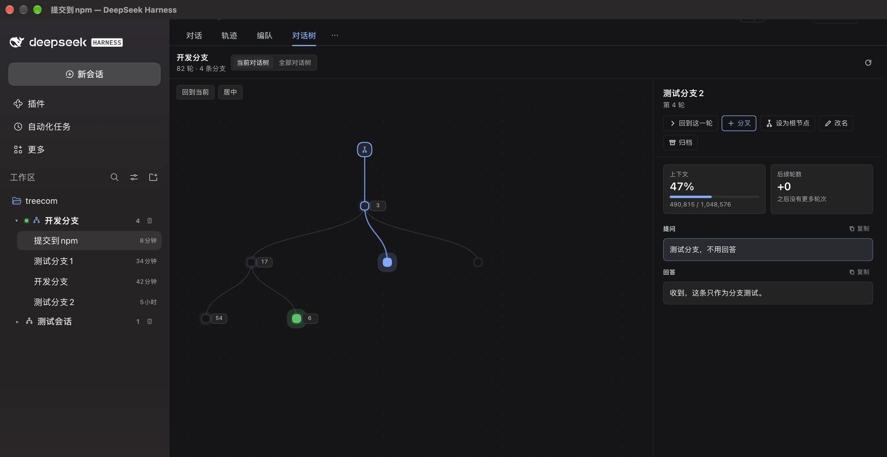

# TreeCom — 对话树

把一段对话的所有分叉管理成一棵可平移、可缩放的画布树。每个分支仍然是普通 DSH 会话，会正常出现在左侧工作区。



版本 **1.0.3** · MIT · DeepSeek Harness Web 插件

## 功能介绍

- **两个入口**：标题栏右上角的「对话树」按钮打开右侧边栏；会话视图中的「对话树」标签页全宽显示画布和详情。
- **画布树**：根节点在上方，分支向下生长；拖动空白处平移，滚轮或触控板缩放，树可以无限延伸。
- **查看节点**：点击节点只会选中并在右侧显示详情，不会切换分支；点「回到这一轮」才会切到该分支并定位。
- **悬停预览**：鼠标停在节点上可快速查看本轮提问、上下文占用和后续轮数；移入预览框不会消失，可直接选中文字、滚动查看完整问答。
- **分叉**：在节点详情里点「分叉」创建新分支；新分支会从父节点逐渐生长出来，并自动获得焦点。空白分支可以直接在右侧的「提问」框里开始对话。
- **详情面板**：显示上下文占用、后续轮数、完整提问 / 回答，支持 Markdown 渲染、复制、重命名、归档和分叉。
- **连续轮次折叠**：没有分叉的连续轮次会合并成一个带数字的节点，点击展开；展开后可折叠上方部分。
- **左侧分组**：左侧会话按对话树分组，同一根节点的会话放在一起，可整体展开 / 收起；当前对话树带一个绿色圆点，生成中时闪烁。
- **树管理**：树文件夹和「全部对话树」列表都支持删除整棵树；删除前会确认，并归档树内所有会话。

## 安装

`dsh plugin` 会把参数转发给 profile 目录里的 pnpm，npm 包名、`github:`、`link:`、`file:` 等 spec 都支持。

**从 npm 安装：**

```bash
dsh plugin --profile web add dsh-treecom
```

**从 GitHub 安装：**

```bash
dsh plugin --profile web add github:Serenity-2026/dsh-treecom
```

**本地开发：**

```bash
git clone https://github.com/Serenity-2026/dsh-treecom.git
dsh plugin --profile web add link:"$PWD/dsh-treecom"
```

安装或更新后需要重新启动 DSH Host，并刷新 Web 页面。

## 如何使用

1. 点标题栏右上角的「对话树」，或切换到会话视图里的「对话树」标签页。
2. 拖动空白区域平移画布，滚轮缩放；用左上角「回到当前」定位当前叶子，用「居中」把树移回视野。
3. 点击任意节点查看右侧详情；点「回到这一轮」切换到该分支继续对话。
4. 在详情里点「分叉」创建新分支。新分支会出现在左侧工作区，但当前对话区仍停留在原分支；点击新分支详情里的「回到这一轮」即可切过去。
5. 对「新分支 / 等待提问」节点，可以直接在右侧「提问」框输入问题并发送，回答会显示在同一个「回答」框中。
6. 用详情里的「重命名」「归档」管理分支；左侧取消归档后，分支会重新回到树里。
7. 连续无分叉的轮次会折叠成带数字的节点，点击展开；悬停展开后的节点可只折叠上方部分。
